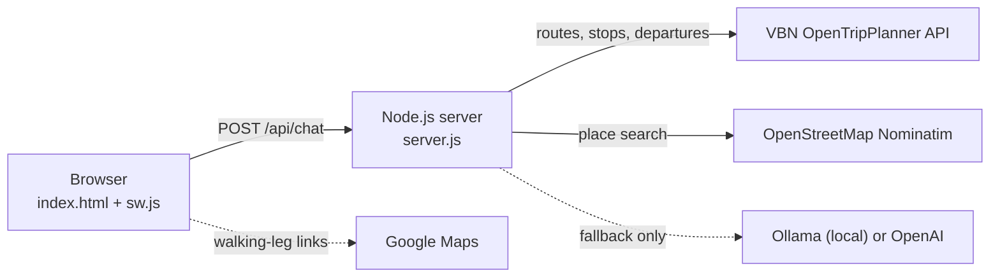

# Architecture

The application is a single Node.js process that serves a static web page and a small JSON API. There is no framework, no build step, no database and no runtime dependency.

## Components

| File | Role |
|---|---|
| `index.html` | Entire frontend: chat UI, language switcher, voice input, geolocation, quick-reply buttons, route rendering, mock-payment modal. Inline CSS and JavaScript. |
| `mock-payment.html` | Stand-alone mock ticket checkout, opened in a new tab (the modal in `index.html` is used if the tab is blocked). Nothing is submitted anywhere. |
| `server.js` | HTTP server, static-file whitelist, chat logic, rule-based parser, place resolution, OTP client, LLM client, session store, translations of server replies. |
| `sw.js`, `manifest.webmanifest` | Progressive-web-app shell (installable, offline fallback page). |
| `route-parser.test.js` | Automated tests (see [testing.md](testing.md)). |

## HTTP interface

| Method and path | Purpose |
|---|---|
| `GET /`, `GET /index.html` and the other whitelisted static files | Only `index.html`, `mock-payment.html`, `sw.js`, `manifest.webmanifest` and the three icons are served; everything else returns 404 (or 403 for paths outside the project). |
| `POST /api/chat` | Main chat endpoint used by the UI. Body: `message`, `selectedLanguage`, `sessionId`, optional `action`, `fromCoords`, `selectedLocation`, `routeSelection`. Returns `reply`, `quickButtons`, `sessionId`, `memory` and, for planned routes, `lastRouteResult`. |
| `POST /api/segment-alternatives` | On-demand alternatives for one transit leg. |
| `POST /api/clear-session` | Deletes the server-side session ("Clear chat"). |
| `POST /api/route` | Lower-level route lookup kept for testing; not used by the UI. |

All `POST /api/*` requests are rate-limited per client address (default 60 per minute, then HTTP 429). Request bodies are limited to 10,000 characters. Error responses never include internal error details; the chat endpoint returns a translated, user-facing message instead.

## Chat request flow

Simplified order of `handleChatRequest` in `server.js`:

1. **Session** — look up or create the in-memory session for `sessionId`.
2. **Button actions and pending questions** — quick-reply actions (plan trip, tickets, accessibility options, change time, …) and answers to a pending question (e.g. a chosen place, the missing origin, current location) are handled first.
3. **Rule-based extraction** — `extractTripDetails` uses regular expressions and keyword lists to find origin, destination, time, date ("tomorrow") and arrive-by/depart-at intent in English, German, Arabic, Turkish, Ukrainian and Hindi. Ticket-only questions and single place names are recognised here as well.
4. **Route planning** — if origin and destination are known, `planRoute` runs (below) and a templated reply is returned. No LLM is involved.
5. **LLM fallback** — only if the message is still not understood: the LLM is asked to return JSON (intent, origin, destination, time, missing field) matching a fixed schema. If that yields a complete trip, `planRoute` runs; otherwise the LLM's short draft reply, or a follow-up question, is returned. Without a configured LLM, this step returns an "AI backend is not configured" message.

Route replies are always produced by templates in `server.js`, not written by the LLM.

## Route planning (`planRoute`)

1. Validate the requested time (past times trigger a clarification).
2. Detect likely typos and offer corrections.
3. Resolve both places (`resolveSupportedLocation`): built-in places and aliases are checked first; numbered street addresses and other address-like text are geocoded with Nominatim; otherwise VBN stop names are searched, with fuzzy matching against built-in places as a last resort. For the chosen place, the nearest VBN stops are looked up. Numbered street addresses must match the geocoder result exactly; they never silently fall back to a stop.
4. For short distances (about 900 m / 12 minutes), recommend walking unless the user asked for public transport.
5. Call `GET {VBN_OTP_API_BASE}/routers/{router}/plan` with `mode=WALK,TRANSIT`, three itineraries, `arriveBy`, Europe/Berlin date and time, and a maximum walking distance of 900 m (300 m with the "less walking" preference).
6. Normalise the itineraries, rank them (fewer transfers, no cancellations, earlier arrival, less walking, less delay, shorter duration) and show the best one plus up to two alternatives.

## LLM integration

- **Ollama** is used when `OLLAMA_BASE_URL` and `OLLAMA_MODEL` are set (`POST /api/chat` on the Ollama server, JSON schema passed as `format`).
- **OpenAI** is used only when the Ollama variables are empty and `OPENAI_API_KEY` is set (Responses API with a strict JSON schema).
- There is no runtime switch between the two: if Ollama is configured but not reachable, the user gets an Ollama error message.
- The prompt includes the last 12 messages of the session and the remembered route, and instructs the model to answer in the selected language and not to invent transport data.

## State

**Server (in memory only):** one session per `sessionId` with the current route, pending questions, ticket-flow state, accessibility preferences and the last 12 messages. Sessions expire after 6 hours of inactivity; at most `MAX_SESSIONS` (default 1000) are kept, least recently used first out. Everything is lost when the process restarts. Caches: VBN stop list (1 hour), resolved places (15 minutes), routes (1 minute), geocoder responses (24 hours).

**Browser:** the session ID, chat history, last route result, selected language and ticket-flow flags are stored in `localStorage` (cleared by "Clear chat"); a few ticket-page flags use `sessionStorage`.

## External services

| Service | Used for | Credentials |
|---|---|---|
| VBN OpenTripPlanner | route plans, stop index, nearby stops, departures | API key (free on request from VBN) |
| OpenStreetMap Nominatim | geocoding streets, addresses, landmarks | none; requests are throttled to ≥1 s apart and cached |
| Ollama | LLM fallback, local | none |
| OpenAI | LLM fallback, cloud | API key |
| Google Maps | links for walking legs (opened by the user) | none |
| Browser Web Speech API | voice input | none; provided by the browser |

## Progressive web app

`sw.js` pre-caches the app shell (page, mock payment page, icons, manifest). Page navigations are fetched from the network first and fall back to the cached page when offline; other `GET` requests are served from the cache first. API calls are `POST` requests and are never cached, so the chat itself needs a connection. Service workers only register on HTTPS or `localhost`.
